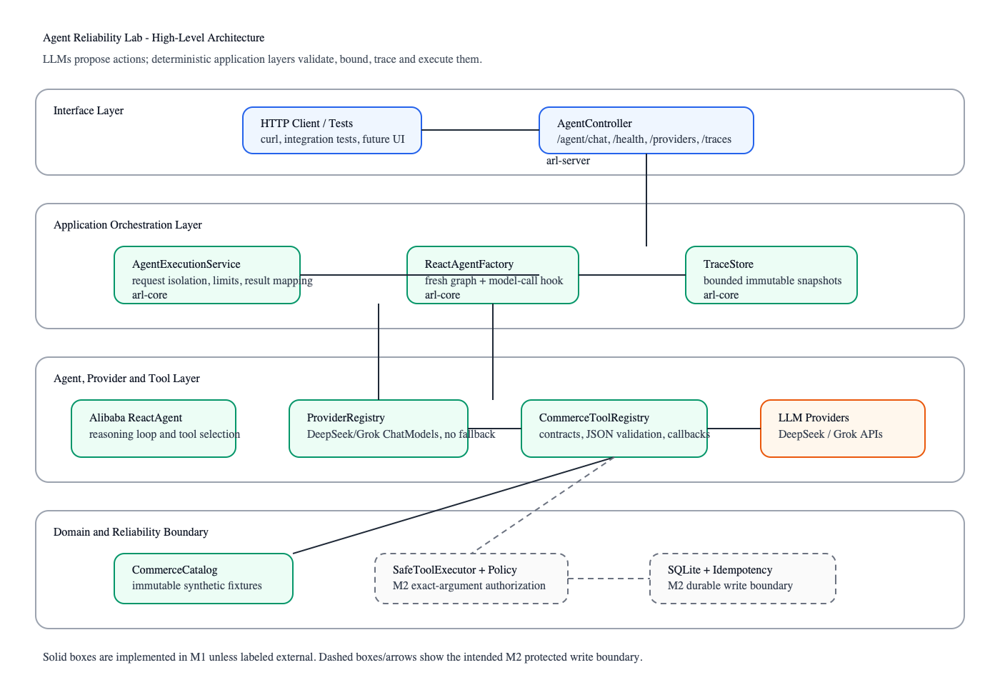
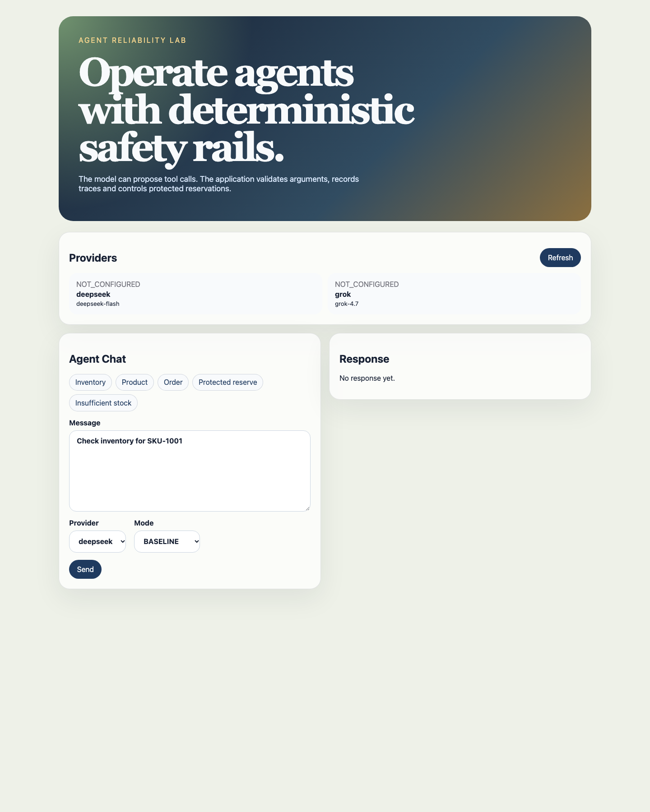

# Agent Reliability Lab

[](https://github.com/chen3862000-coder/agent-reliability-lab/actions/workflows/verify.yml)

[](LICENSE)

**Don't just build agents. Make them reliable.**

Agent Reliability Lab (ARL) is a Java/Spring research application for adding
deterministic reliability controls around LLM agents. Models may propose actions;
application-owned systems validate, bound, trace and execute them.

The local demo uses synthetic commerce data, Alibaba `ReactAgent`, Spring AI
OpenAI-compatible clients for DeepSeek/Grok, SQLite-backed confirmation-gated inventory
reservations, deterministic offline evaluation and a React UI.



*The browser UI is an API client. Safety and write decisions remain in the backend.*



## Features

- HTTP API for agent chat, health, provider status, confirmation and traces.
- Read tools for product, inventory and order data.
- `BASELINE` reservation proposals do not mutate stock; `PROTECTED` proposals require a separate confirmation.
- SQLite transactions and idempotency keys protect the reservation write path.
- Bounded in-memory traces record model and tool events.
- Offline evaluator with 59 deterministic cases across 10 reliability categories.
- React demo for chat, provider status, confirmation and trace inspection.
- Docker Compose local demo with health-gated startup and persistent SQLite volume.

## Scope

ARL is a local demo, not a production commerce service. It has no authentication,
identity-bound confirmation authorization, or durable trace/audit store. Offline cases
check deterministic application contracts; they do not measure autonomous model quality.
Live provider tests are opt-in and their evidence is provider-specific.

## Run the Demo

Requirements: Docker Engine and Docker Compose for the container demo, or Java 27, Node 24
and npm 11 for running processes locally. Provider keys are optional for startup and
provider-status viewing, but required for chat and may incur charges.

### Containerized

```sh
ARL_DEFAULT_PROVIDER=deepseek DEEPSEEK_API_KEY='your-deepseek-key' make demo
```

Open `http://127.0.0.1:8088`. Compose health-gates frontend startup and stores SQLite in
the `arl-data` named volume. To stop the stack while preserving its data:

```sh
make demo-down
```

Use `make demo-cold` for an uncached image build. A cold build was verified on Apple
Silicon Docker Desktop in about 2m44s; actual duration depends on host/network conditions.
Provider keys are runtime environment variables, never image build arguments.

### Local Processes

Start the backend in one terminal:

```sh
export ARL_DEFAULT_PROVIDER=deepseek
export DEEPSEEK_API_KEY='your-deepseek-key'
# Optional: persist stock/idempotency across restarts
export ARL_DB_PATH="$PWD/target/local/arl.db"
make start
```

In another terminal, install and start the frontend:

```sh
make frontend-install
make frontend-dev
```

Open `http://127.0.0.1:5173`. The Vite server proxies API requests to
`http://127.0.0.1:8080`. For Grok, use `ARL_DEFAULT_PROVIDER=grok` and `XAI_API_KEY`.
ARL does not automatically load `.env`; export values in the shell that starts the app.

### Try the Flows

1. Check that the provider panel shows the provider as `CONFIGURED`.
2. Choose the `Inventory` sample prompt and send it in `BASELINE` mode.
3. Choose `Protected reserve`, submit the proposal, then confirm it in the reservation card.
4. Load the trace to inspect ordered model/tool events.

Example API requests:

```sh
curl http://127.0.0.1:8080/health
curl http://127.0.0.1:8080/providers
curl http://127.0.0.1:8080/agent/chat -H 'Content-Type: application/json' \
  -d '{"message":"Check inventory for SKU-1001","provider":"deepseek","mode":"BASELINE"}'
```

Expected outcomes: missing keys yield `PROVIDER_NOT_CONFIGURED`; insufficient inventory
does not produce a confirmation; replaying the same confirmation/key returns the prior
result; using that key with another confirmation returns `IDEMPOTENCY_KEY_REUSED`. Blank
`ARL_DB_PATH` resets in-memory stock on restart; file-backed SQLite preserves it.

## Verification

```sh
make verify
```

The canonical gate runs Java checks/tests, coverage and architecture checks, requirement
evidence, frontend tests/build and `npm audit --audit-level=high`. `make format` applies
Java formatting.

Run deterministic offline evaluation separately:

```sh
make evaluate
```

This writes `target/evaluation/report.json`. Its routing-contract metric compares observed
tool execution with scenario-declared expectations; scripted models follow those
expectations, so the metric is not a measure of autonomous model routing quality. Live
provider tests are opt-in with `make live-test` and credentials.

## Project Structure

- `arl-core`: providers, agent orchestration, tools, policy, domain and trace store.
- `arl-server`: Spring Boot composition root and HTTP API.
- `arl-evaluation`: offline scenario runner and JSON reports.
- `frontend`: Vite React TypeScript API client.
- `docs/`: architecture, status, compatibility, requirements and quality documentation.

## Documentation

- [Project status](docs/project-status.md)
- [Architecture](docs/architecture.md)
- [Requirements and configuration](docs/requirements.md)
- [Quality harness](docs/quality-harness.md)
- [Framework compatibility and provider evidence](docs/framework-compatibility.md)
- [Historical M1 implementation snapshot](docs/m1-implementation.md)
