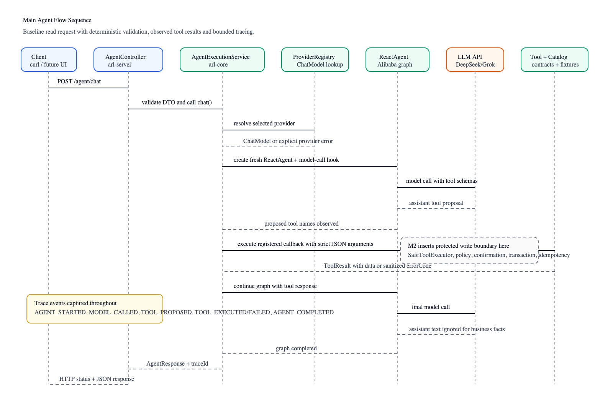

# System Architecture

Agent Reliability Lab (ARL) is designed around one rule: **LLMs propose actions;
deterministic systems validate, bound, trace and execute them**. The application uses
Alibaba `ReactAgent` for model interaction and tool selection, while ARL owns provider
configuration, tool contracts, execution boundaries, response mapping and trace evidence.

This document describes the intended final architecture, then calls out what is currently
implemented in M4 and what remains future work.

## Architecture Goals

- Keep model reasoning separate from trusted business execution.
- Make provider choice explicit, observable and non-fallback.
- Isolate every request with a fresh agent graph, hook state and trace.
- Treat provider output as untrusted until validated against tool contracts and domain rules.
- Preserve an auditable path from user request to model call, tool proposal, tool result and final response.
- Add protected writes only behind deterministic authorization, confirmation, transaction and idempotency controls.
- Keep UI and evaluation code outside the trusted execution boundary; both consume APIs or core services but do not own safety decisions.

## High-Level Architecture

ARL is a small layered system:

- **Interface layer**: HTTP clients and the M4 React frontend call Spring MVC endpoints in `arl-server`. Controllers own transport validation and HTTP status mapping, not business execution.
- **Application orchestration layer**: `AgentExecutionService` coordinates one request at a time, resolves provider/model metadata, creates a fresh agent and converts observed tool results into the API response.
- **Agent, provider and tool layer**: Alibaba `ReactAgent` runs the reasoning graph. `ProviderRegistry` supplies immutable DeepSeek/Grok `ChatModel` instances. `CommerceToolRegistry` supplies callback contracts, strict JSON argument validation and deterministic tool results.
- **Domain and reliability boundary**: M4 reads deterministic `CommerceCatalog` fixtures and mutates inventory only through confirmation-gated SQLite transactions with idempotency records. SQLite may run in-memory or file-backed via `ARL_DB_PATH`.
- **Evaluation and demo layer**: `arl-evaluation` runs deterministic offline scenarios with scripted models, while `frontend` provides a browser demo that remains API-client-only.

## Modules and Ownership

### `arl-core`

Owns reusable agent and reliability logic:

- `ProviderRegistry`: immutable provider configuration, credential gating, timeout/retry settings and DeepSeek transport workaround.
- `ReactAgentFactory`: fresh Alibaba `ReactAgent` graph plus model-call limit hook per request.
- `AgentExecutionService`: orchestration, model/tool observation, bounded execution, sanitized error mapping and result construction.
- `CommerceToolRegistry`: central tool contracts, schemas, validation, callback creation and deterministic tool execution.
- `CommerceCatalog`: SQLite-backed synthetic commerce data, reservation confirmations and idempotency records.
- `TraceStore`: bounded in-memory trace snapshots.

`arl-core` must stay independent of Spring Boot composition and must not depend on `arl-server`.

### `arl-server`

Owns runtime composition and HTTP transport:

- `ArlApplication`: Spring Boot entrypoint, bean wiring and environment/YAML-backed provider settings.
- `AgentController`: `/agent/chat`, `/agent/confirm`, `/health`, `/providers` and `/traces/{traceId}` endpoints.
- `ApiErrors`: sanitized routing and framework error responses.

`arl-server` depends on `arl-core`; dependency direction does not reverse.

### `arl-evaluation`

Owns deterministic offline evaluation:

- `EvaluationRunner`: executes code-defined scenarios against isolated `CommerceCatalog` state and scripted `ChatModel` responses.
- `EvaluationReport`: JSON report model with pass/fail, safety, protected-write and trace-completeness metrics.
- `EvaluationMain`: command-line entry point used by `make evaluate`.

`arl-evaluation` depends on `arl-core`; it does not run during normal server startup and does not call paid providers.

### `frontend`

Owns the M4 browser demo:

- Vite React TypeScript app under `frontend/`.
- API client functions for `/providers`, `/agent/chat`, `/agent/confirm` and `/traces/{traceId}`.
- UI panels for provider status, agent chat, protected reservation confirmation and trace viewing.
- Tests for confirmation extraction and client-generated idempotency key formatting.

The frontend is intentionally not a safety boundary. It never calls model providers directly, never reads SQLite directly and never authorizes writes; it only sends backend-issued confirmation IDs plus client-generated idempotency keys to the server.

Create new modules only when they contain executable functionality.

## Main Agent Flow

Main request flow for `POST /agent/chat`:

1. Client submits `message`, optional `provider` and optional `mode`.
2. `AgentController` validates the request DTO and delegates to `AgentExecutionService`.
3. `AgentExecutionService` resolves the selected provider through `ProviderRegistry` and creates a fresh `ReactAgent` through `ReactAgentFactory`.
4. `ReactAgent` calls the selected provider with registered tool schemas.
5. The model may propose tool calls; ARL records each proposed tool name before execution.
6. `CommerceToolRegistry` rejects unknown tools and malformed arguments, then executes registered callbacks against deterministic domain data.
7. Tool results are returned to the graph; ARL keeps observed tool results as the source of business response text.
8. The final API response contains status, message, sanitized error code when present, trace ID, provider/model metadata, observed tool names and structured results.
9. `TraceStore` retains immutable snapshots of completed traces for later lookup.

Important current behavior: model narrative is not exposed as business truth. A successful response is built from observed tool results, and a tool/provider failure remains a failure even if the model later claims success.

## Frontend Demo Flow

The M4 frontend adds a browser workflow over the same backend APIs:

1. Vite dev server serves the React app on `127.0.0.1:5173` and proxies `/agent`, `/providers`, `/health` and `/traces` to `127.0.0.1:8080`.
2. The provider panel calls `GET /providers` and shows configured status and model names. Configured does not mean live-verified.
3. The chat form posts `message`, `provider` and `mode` to `POST /agent/chat`.
4. The response panel displays server-returned status, message, error code, model metadata, trace ID, tool calls and structured tool results.
5. If a protected reservation proposal includes `confirmationId`, the frontend shows a confirmation card and generates a client idempotency key.
6. The confirmation card posts `confirmationId` and `idempotencyKey` to `POST /agent/confirm`; only the backend mutates stock.
7. The trace viewer calls `GET /traces/{traceId}` and displays the ordered trace events returned by the backend.

## Execution and Trust Boundaries

### Current M4 Boundary

Baseline tools are local and read-only except for `reserve_inventory`, which validates a proposal and returns `RESERVATION_NOT_ENABLED`. Protected mode creates a confirmation token for `reserve_inventory`; `POST /agent/confirm` consumes that token with a client idempotency key before stock changes. The React frontend can present this flow, but the trusted boundary remains on the backend.

The current trusted boundary is:

`ReactAgent -> registered ToolCallback -> CommerceToolRegistry validation -> confirmation record -> POST /agent/confirm -> SQLite transaction -> idempotent ReservationCommit`

### Protected Write Boundary

The implemented M4 path uses this boundary:

`ReactAgent -> registered ToolCallback -> SafeToolExecutor -> strict argument validation -> business constraints -> policy -> trusted authorization -> transaction -> domain result`

Key rules for protected writes:

- The callback is the only protected tool entry point.
- Tool interceptors may trace, but interceptors alone are not the authorization boundary.
- The model never assigns trusted idempotency keys or grants authorization.
- Confirmation records bind operation, canonical arguments and expiry. They are not bound to
  an authenticated user/session in this local demo.
- SQLite atomically consumes confirmation, changes stock and records the idempotent result; conditional affected-row checks enforce the write invariant. File-backed databases preserve those records across restarts.
- A unique key plus operation fingerprint prevents duplicate effects and key reuse with changed arguments.
- Ambiguous write failures are reconciled against durable records, never blindly retried.

## Provider Architecture

ARL uses Spring AI OpenAI-compatible `ChatModel` implementations for both providers:

- DeepSeek: `https://api.deepseek.com/chat/completions`
- Grok: `https://api.x.ai/v1/chat/completions`

Design decisions:

- Only `deepseek` and `grok` are valid provider IDs.
- There is no automatic provider fallback.
- Missing credentials keep providers unconfigured; clients are not constructed for absent keys.
- Provider defaults are immutable after registry construction.
- Each invocation gets fresh agent/hook state; checkpoint/thread IDs are not shared.
- SDK retries are disabled; model calls are bounded by the application hook.
- DeepSeek receives a transport-level `thinking: {type: disabled}` workaround until an upgraded adapter passes equivalent wire tests.
- Grok must not receive DeepSeek-only options such as `ARL_LLM_TEMPERATURE`.

## Trace and Response Model

Traces are diagnostic evidence, not durable audit records in M4. The latest 256 completed traces are retained in memory and evicted afterward.

Trace events include:

- `AGENT_STARTED`
- `MODEL_CALLED`
- `MODEL_COMPLETED`
- `MODEL_FAILED`
- `TOOL_PROPOSED`
- `TOOL_EXECUTED`
- `TOOL_FAILED`
- `AGENT_COMPLETED`

Responses include `status`, `message`, `errorCode`, `traceId`, `provider`, `model`, `toolCalls` and `results`. Provider exceptions and routing errors are sanitized; raw provider details and credentials are not returned.

These are **application-generated structured responses**, not model-enforced structured
output. ARL does not currently configure Alibaba `ReactAgent.outputSchema()` or validate a
final model response against a response schema. For business facts, the implementation
deliberately builds response text from validated tool results and ignores free-form model
narrative.

## Evaluation Architecture

M3/M4 verification separates deterministic offline evaluation from live provider claims:

- `make evaluate` runs `arl-evaluation` with scripted models and isolated SQLite catalog state per scenario.
- The report is written to `target/evaluation/report.json` and includes pass/fail counts, safety violations, protected-write passes and trace completeness.
- Evaluation scenarios exercise read flow, malformed arguments, unknown tools, provider failure, insufficient inventory, baseline no-write behavior and protected reservation confirmation.
- The offline suite does not use provider API keys, does not measure live model quality and does not establish provider entitlement.

## Key Design Decisions

- **Use Alibaba `ReactAgent`, not a custom ReAct loop.** ARL verifies framework integration instead of reimplementing graph execution.
- **Keep core independent from Boot composition.** `arl-core` contains reusable agent/domain logic; `arl-server` wires runtime beans and HTTP transport.
- **Prefer deterministic tool results over model narrative.** The model can select tools, but observed tool output drives business responses.
- **Fail explicitly rather than falling back.** Unknown provider, unconfigured provider, unsupported mode and invalid requests have explicit error codes.
- **Bound execution.** M4 caps model calls, accepted tool proposals, provider timeout, output tokens and trace retention.
- **Retry only safe local reads.** SQLite BUSY failures on read-only catalog queries receive a small bounded retry budget and deadline. Provider model calls and write transactions keep SDK retries disabled; writes are reconciled only by replaying the same idempotency key.
- **Confirm writes outside the model loop.** The model may propose a reservation, but stock changes only through `POST /agent/confirm` with a client idempotency key. This is confirmation-gated execution, not production-grade identity-bound authorization or a full HITL policy system.
- **Separate offline verification from live provider claims.** Stubbed tests prove wiring and regression behavior; live accuracy/entitlement remain opt-in evidence.
- **Keep evaluation deterministic by default.** The 59 M3 cases across 10 categories use scripted models and isolated SQLite state; routing-contract matches validate scenario-declared tool expectations, not autonomous model quality.
- **Keep the frontend thin.** M4 improves demo usability, but all validation, confirmation, idempotency and mutation decisions stay in backend/core code.
- **Distinguish response structure from model output structure.** ARL returns typed API/tool result objects, but does not currently enforce a model `outputSchema`; business response text is derived from tool results rather than model narrative.

## Current Phase vs Upcoming Changes

Current M4 Implementation:

- Synthetic commerce agent with REST chat, protected reservation confirmation and traces.
- `BASELINE` mode for reads/proposals and `PROTECTED` mode for confirmation-gated reservation proposals.
- SQLite-backed catalog state with optional file persistence and in-memory traces.
- DeepSeek/Grok provider configuration and offline transport regressions.
- Confirmed reservation execution with idempotency-key replay protection and stock mutation.
- Offline evaluation runner with JSON report metrics for safety, trace completeness and protected writes.
- React/Vite frontend demo for provider status, chat, confirmation and trace viewing.
- Docker Compose local demo stack with persistent SQLite volume and health-gated startup.
- `make verify` validates Java modules, requirement evidence and frontend tests/build; `make frontend-verify` focuses the UI.

Upcoming Changes:

- Live/provider-quality evaluation remains future work; current evaluation covers deterministic offline behavior only.
- Production deployment concerns remain future work: authentication, durable trace/audit storage, production container hardening and hosted deployment. Local Docker Compose packaging is implemented.
- Broader commerce writes beyond `reserve_inventory` require separate approval and equivalent protected-write evidence.
- Ambiguous write-failure reconciliation can be hardened beyond recorded idempotent results.
- Frontend polish can continue, but frontend code must remain API-client-only and must not own authorization decisions.

Do not claim future behavior until the relevant milestone is approved, implemented and verified by `make verify` plus any required live/manual evidence.
