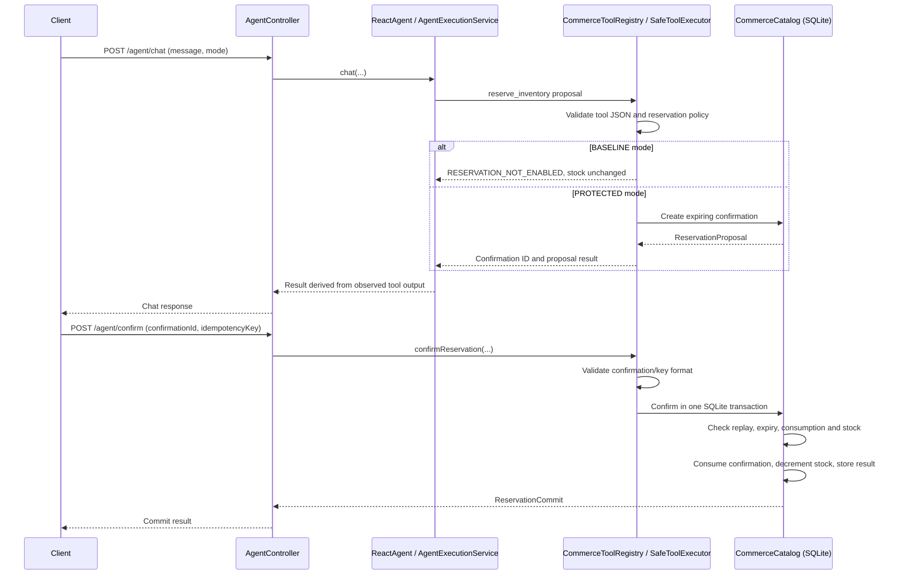

# Domain-Driven System Design

## Purpose and Scope

This document explains the implemented Agent Reliability Lab (ARL) system through
Domain-Driven Design (DDD) concepts. It describes the code as it exists, rather than
presenting a target architecture as though it had already been implemented. ARL is a
local research/demo application with synthetic commerce data. Its central design rule is:
**the model may propose actions; deterministic application code validates and controls
execution**.

The system demonstrates a narrow protected reservation workflow. It is not a production
commerce service, an authenticated authorization system, or a live evaluation of model
quality. For current scope and caveats, see [Project Status](project-status.md).

## DDD View at a Glance

ARL has DDD-aligned boundaries, but it does not implement every tactical DDD pattern as
separate classes. The module layout and service boundaries make responsibilities
identifiable; some responsibilities remain combined in concrete classes.

| DDD concept | Current implementation |
| --- | --- |
| Core domain | Synthetic commerce reads and confirmation-gated inventory reservation |
| Supporting domain | Agent orchestration, provider integration, trace capture and deterministic evaluation |
| Bounded contexts | Commerce/reservation, agent execution, provider integration, HTTP/runtime, offline evaluation and browser demo |
| Aggregate-like consistency boundary | `CommerceCatalog` coordinates reservation, confirmation consumption, inventory mutation and idempotency in SQLite; no explicit aggregate-root class exists |
| Entities and value-like data | Catalog records and persisted confirmation/idempotency rows; records are mostly data carriers, not rich domain objects |
| Domain policy | `ReservationPolicy` validates proposal and confirmation inputs and business constraints |
| Application services | `SafeToolExecutor` and `AgentExecutionService` coordinate use cases at different trust boundaries |
| Ports and adapters | `LlmProviderRegistry` is an explicit provider port; Spring MVC, SQLite and provider SDK integration are concrete adapters, not all abstracted behind ports |
| Domain events | None. `TraceStore` contains diagnostic execution events, not domain events or a durable audit log |

`arl-core` contains the reusable business/reliability behavior. `arl-server` is the Spring
Boot composition root and HTTP adapter. `arl-evaluation` exercises core behavior with
scripted models. The React frontend is an API client. Dependency direction is from server
and evaluation toward core, not the reverse.

## Ubiquitous Language

These terms are used in this document in the same sense as the implementation:

| Term | Meaning |
| --- | --- |
| **Tool proposal** | A model-requested invocation of a registered tool. It is untrusted input, not an authorized business operation. |
| **Reservation proposal** | A validated request to reserve a SKU and quantity. In `PROTECTED` mode it creates a confirmation record but does not decrement stock. |
| **Confirmation** | A backend-generated, expiring identifier for one proposed reservation. The demo does not bind it to a user or session. |
| **Confirmation request** | A separate client request carrying a confirmation ID and idempotency key to attempt the write. |
| **Idempotency key** | A client-generated key that lets a repeated confirmation request retrieve its prior result without repeating the stock effect. |
| **Reservation commit** | The result of processing a confirmation request; success, rejection, or a retry-same-key signal. |
| **Trace** | A bounded, in-memory diagnostic record of agent, model, and tool execution. It is not durable audit evidence. |

## Bounded Contexts and Responsibilities

These contexts are logical boundaries within the current application, not independently
deployed services or separate databases.

### Commerce Catalog and Reservation

**Purpose:** expose deterministic product, inventory, and order reads and enforce the
reservation lifecycle.

**Implementation:** `dev.arl.domain.CommerceCatalog` owns the SQLite schema, seeded
synthetic data, queries, confirmation records, idempotency records, transaction handling,
and the stock decrement. `dev.arl.tools.ReservationPolicy` applies deterministic
reservation rules. `dev.arl.tools.SafeToolExecutor` is the trusted boundary used for
reservation proposals and confirmations.

**Consistency boundary:** the confirmation state change, inventory decrement, and stored
idempotency result are committed in one SQLite transaction. Conditional updates and
affected-row checks prevent consuming one confirmation twice or decrementing stock below
zero. This is a local-database guarantee; it is not evidence for multi-host consistency.

### Agent Execution

**Purpose:** turn a user chat request into a bounded execution using a selected model and
registered tools, then construct an application response from observed results.

**Implementation:** `AgentExecutionService` validates request-level fields, resolves the
provider, creates per-invocation state, observes model/tool activity, limits accepted tool
proposals, maps failures to safe error codes, and builds the response. `ReactAgentFactory`
creates the Alibaba `ReactAgent` graph and a fresh model-call-limit hook for the request.
The framework owns the reasoning loop; ARL does not implement a custom ReAct loop.

**Important distinction:** the API response is typed application output, but the model's
final narrative is not validated using a configured model output schema. Business response
text is derived from observed tool results, so an unverified model claim is not treated as
the source of business facts.

### Provider Integration

**Purpose:** make provider selection explicit and isolate provider-specific configuration
and transport behavior.

**Implementation:** `LlmProviderRegistry` is the port consumed by agent orchestration.
`ProviderRegistry` is its concrete Spring AI adapter for DeepSeek and Grok. It constructs
clients only when credentials are present, uses explicit provider IDs, applies bounded
timeouts, and disables SDK retries. Provider selection does not fall back automatically.
The provider status endpoint reports configuration, not entitlement or live availability.

### HTTP and Runtime Composition

**Purpose:** expose the application through HTTP and assemble runtime dependencies.

**Implementation:** `AgentController` owns request DTO validation, routes chat and
confirmation requests to core services, and maps application error codes to HTTP status
codes. `ApiErrors` maps malformed or unmatched requests to sanitized responses. `ArlApplication`
composes the core services, provider registry, catalog and bounded trace store from Spring
configuration.

HTTP is a transport adapter; it does not own reservation invariants. Authentication and
identity-bound authorization are not implemented.

### Offline Evaluation

**Purpose:** check deterministic application contracts without contacting paid model APIs.

**Implementation:** `arl-evaluation` runs code-defined scenarios with scripted chat models
and isolated in-memory catalog state. It records scenario outcomes, tool-contract matches,
safety, idempotency/recovery, and trace completeness in a JSON report. These scripted tests
do not establish live model quality or autonomous routing ability.

### Browser Demo

**Purpose:** provide a human-readable client for the HTTP API.

**Implementation:** the React/Vite frontend displays provider configuration, chat results,
confirmation proposals and traces. It sends confirmation IDs and client-generated
idempotency keys to the backend. The browser does not call providers directly, read
SQLite, or make trusted authorization decisions.

## Reservation Model and Invariants

### Data Concepts

`CommerceCatalog` defines immutable Java records for `Product`, `Inventory`, `Order`,
`ReservationProposal`, and `ReservationCommit`. The records describe values crossing
application boundaries; most business behavior is in `ReservationPolicy`,
`SafeToolExecutor`, and `CommerceCatalog`, rather than methods on rich entities.

SQLite stores products, inventory, orders, confirmations, and idempotency results. A
confirmation contains the reservation operation, SKU, quantity, fingerprint, expiry, and
consumed state. An idempotency row stores the associated confirmation and result needed to
replay the response.

### Business Invariants

- Reservation quantity is between 1 and 1000 inclusive.
- A proposal requires a known SKU and sufficient currently available inventory.
- `BASELINE` mode does not create a stock-changing reservation; it returns
  `RESERVATION_NOT_ENABLED` for a valid reservation request.
- `PROTECTED` mode may create a confirmation that expires after five minutes; proposal
  creation alone does not change stock.
- A confirmation may be consumed only once and before expiry.
- Stock must remain nonnegative; the database update also requires sufficient stock at
  commit time, so proposal-time availability is not treated as a guarantee of later stock.
- A repeated idempotency key with the same confirmation returns the recorded result. Using
  that key for another confirmation returns `IDEMPOTENCY_KEY_REUSED`.
- Write contention returns `WRITE_BUSY_RETRY_SAME_KEY`; callers must retry with the same
  confirmation and key. The application does not blindly retry write side effects.

### Reservation Lifecycle



The diagram shows the implemented logical flow. It does not imply user authentication,
identity-bound approval, or durable trace capture.

## Model, Tool, and Trust Boundaries

The model is an untrusted proposer. The tool boundary is enforced in application code:

1. `CommerceToolRegistry` exposes a small allow-list of tool contracts and strictly parses
   JSON arguments, rejecting malformed structures, duplicate keys, trailing tokens,
   unknown fields, and invalid identifiers.
2. `AgentExecutionService` rejects unregistered tool names and bounds accepted tool
   proposals. `ReactAgentFactory` bounds model calls and graph execution.
3. Read tools return catalog data. Reservation proposals are routed through
   `SafeToolExecutor` and `ReservationPolicy`.
4. The confirmation endpoint is separate from the model's tool loop. It passes
   backend-issued confirmation IDs through deterministic validation and the SQLite
   transaction boundary.
5. Provider failures and internal details are reduced to bounded error codes. Trace events
   intentionally omit prompts, arguments, and credentials.

The confirmation is a demo safety control, not authorization: the application has no
authentication and does not bind confirmation IDs to a user or session. Do not describe
this system as identity-bound authorization or a complete human-in-the-loop policy system.

## Layering and Dependency Direction

```text
React browser client
        | HTTP
        v
arl-server: Spring composition + HTTP transport
        | calls core services
        v
arl-core: agent orchestration, tools/policy, catalog, provider port, traces
        ^                         |
        |                         +--> provider SDK / remote LLM APIs
arl-evaluation                         (explicitly selected; no fallback)
  scripted models + isolated core state
```

The module graph is intentionally simple: server and evaluation use core; core does not
depend on Spring Boot composition or on sibling ARL modules. Some low-level integrations
remain direct: `CommerceCatalog` owns JDBC/SQLite rather than delegating to a repository
port, and the HTTP controllers depend directly on core application types. This keeps the
demo small but means the code should not be described as a fully hexagonal architecture.

## Consistency, Retry, and Observability

- Confirmation, inventory, and idempotency result form one SQLite transaction boundary.
- SQLite BUSY reads have a small bounded retry budget and deadline. Writes are not retried
  automatically; a caller can safely resubmit using the same idempotency key.
- Provider SDK retries are disabled. Each invocation gets fresh agent/hook/run state so
  checkpoints, callbacks, and traces are not shared across requests.
- `TraceStore` keeps bounded in-memory diagnostic snapshots (currently up to 256 completed
  traces). Traces are cleared on restart, may be evicted, and are not an audit store.
- Trace events such as `MODEL_CALLED` and `TOOL_EXECUTED` describe execution telemetry;
  they are not domain events and are not used to reconstruct commerce state.

SQLite persistence is suitable for the local demo and has tests using multiple connections
to one local file. It does not establish distributed consistency or multi-instance behavior.

## Design Tradeoffs and Evolution Seams

Current choices are appropriate for a small, executable demo, but the code has clear seams
if the domain grows:

- `CommerceCatalog` currently combines catalog queries, reservation domain operations,
  SQLite schema, persistence and transaction mechanics. If more business behavior or
  storage backends are introduced, separate domain-facing catalog/reservation operations
  from a repository or persistence adapter while keeping the transaction invariant intact.
- Reservation data is represented by records plus policy/service methods rather than an
  explicit `Reservation` aggregate with encapsulated transitions. A richer reservation
  lifecycle could introduce explicit domain types and methods once more states or business
  rules justify that complexity.
- `SafeToolExecutor` coordinates business policy and persistence calls. Keep it as a
  trusted application boundary; do not move authorization decisions into the model, tool
  schema, or frontend.
- `LlmProviderRegistry` demonstrates a port, while provider clients are infrastructure
  details. Preserve explicit selection and no-fallback behavior if providers change.
- Traces are diagnostic and ephemeral. A durable audit requirement would need a separate
  design, retention/privacy rules, and failure semantics; simply persisting the current
  trace map would not establish an audit system.
- The reservation confirmation is not identity-bound. Production authorization requires
  authentication, ownership checks, and a separate security design.
- New commerce writes require the same strict validation, confirmation policy, transaction,
  idempotency, and evidence boundaries; broader writes are outside the current scope.

These are evolution options, not claims that the abstractions or capabilities already
exist. Keep new executable modules tied to actual functionality and preserve the current
separation between automated verification, offline evaluation, manual review, and live
provider evidence.

## Code Map

| Responsibility | Main implementation |
| --- | --- |
| Commerce data and reservation transaction | `arl-core/src/main/java/dev/arl/domain/CommerceCatalog.java` |
| Reservation policy and trusted executor | `arl-core/src/main/java/dev/arl/tools/ReservationPolicy.java`, `SafeToolExecutor.java` |
| Model-facing tool contracts | `arl-core/src/main/java/dev/arl/tools/CommerceToolRegistry.java` |
| Agent orchestration and response construction | `arl-core/src/main/java/dev/arl/agent/AgentExecutionService.java` |
| Fresh Alibaba agent graph and hook | `arl-core/src/main/java/dev/arl/agent/ReactAgentFactory.java` |
| Provider port and concrete integration | `arl-core/src/main/java/dev/arl/llm/LlmProviderRegistry.java`, `ProviderRegistry.java` |
| Trace capture | `arl-core/src/main/java/dev/arl/observability/TraceStore.java` |
| HTTP adapter and runtime composition | `arl-server/src/main/java/dev/arl/server/AgentController.java`, `ArlApplication.java` |
| Offline scripted evaluation | `arl-evaluation/src/main/java/dev/arl/evaluation/` |
| API client and browser demo | `frontend/src/` |

See also [System Architecture](architecture.md), [Quality Harness](engineering/quality-harness.md),
[Code Review Checklist](engineering/code-review.md), and [Project Status](project-status.md).
